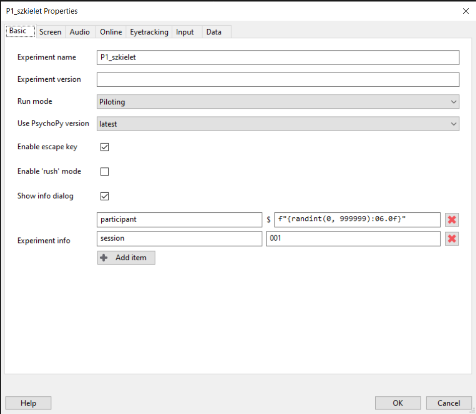
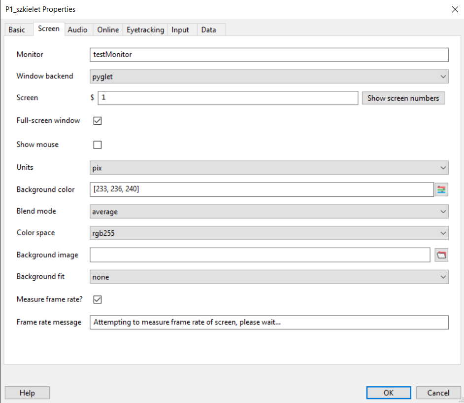
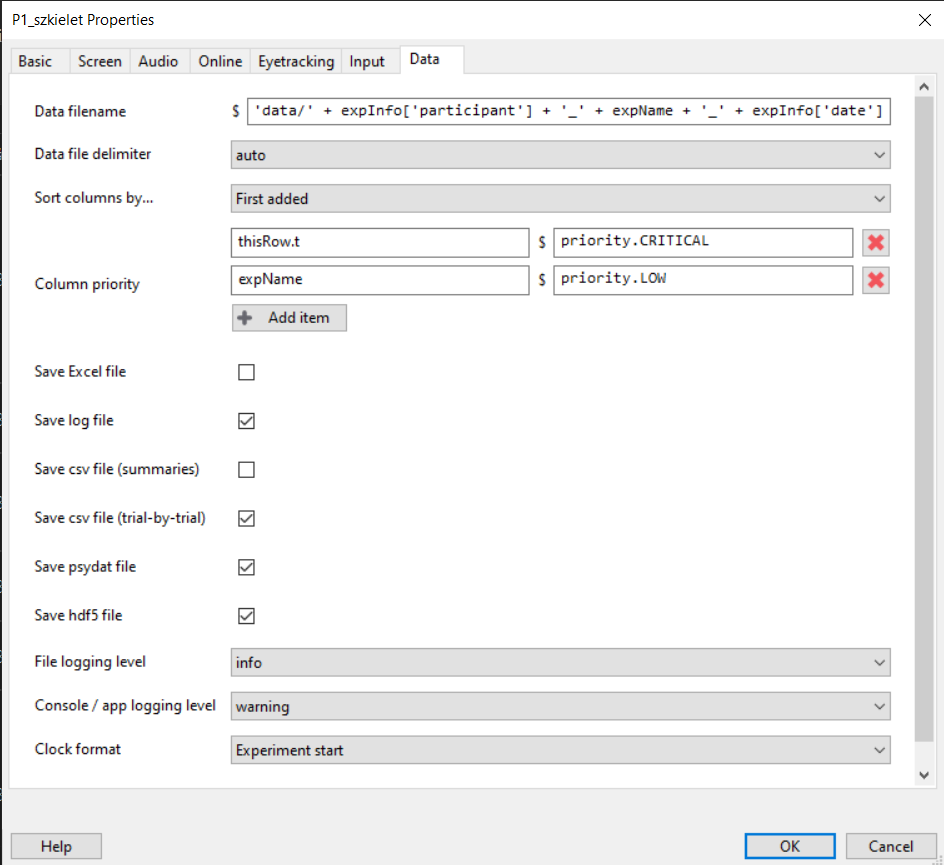
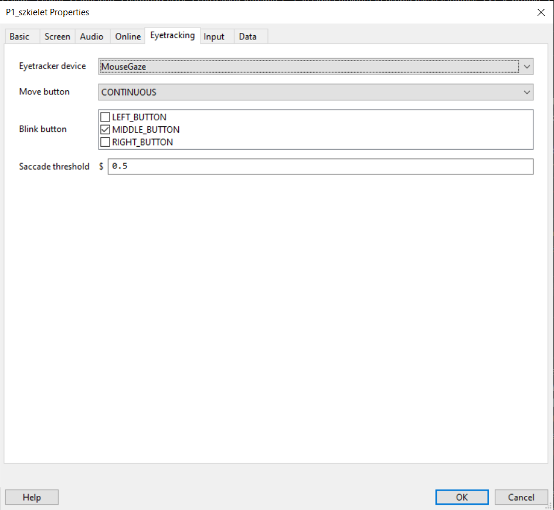
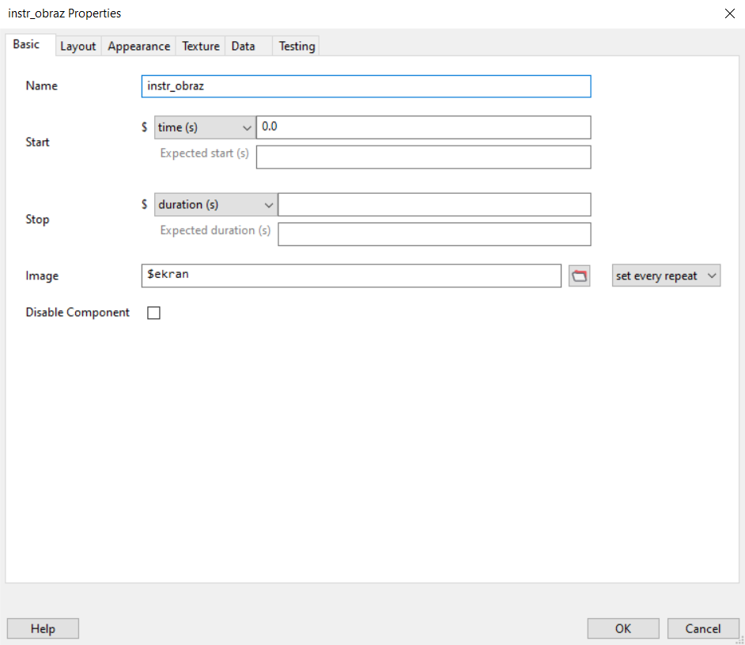
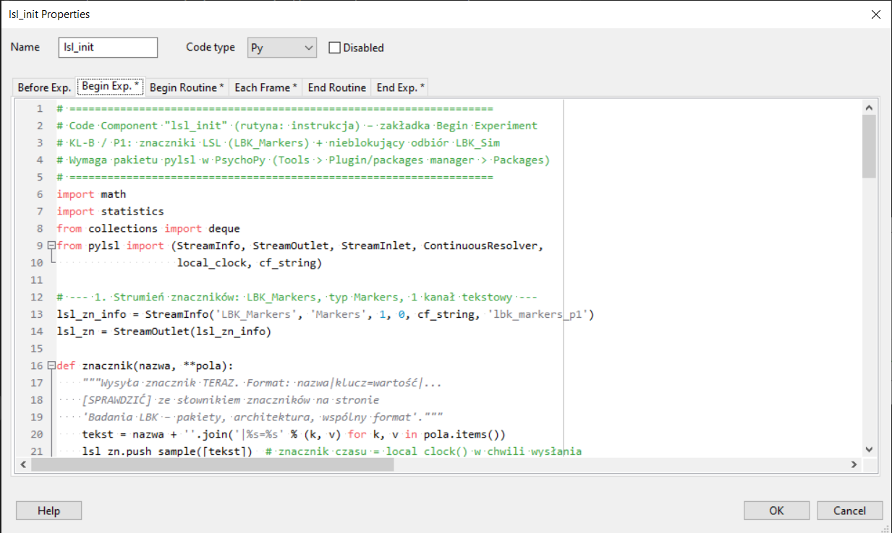
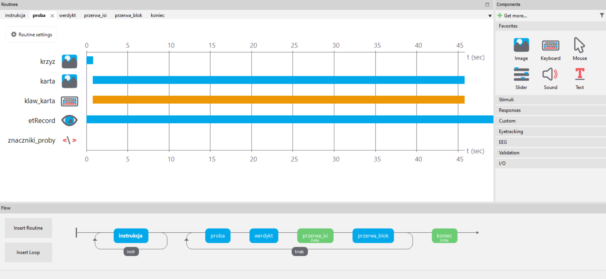
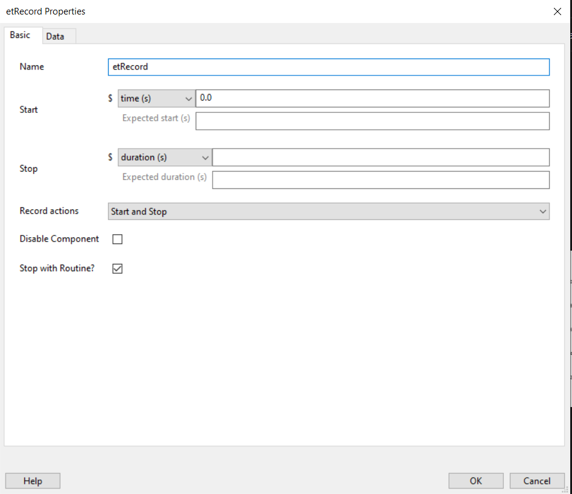
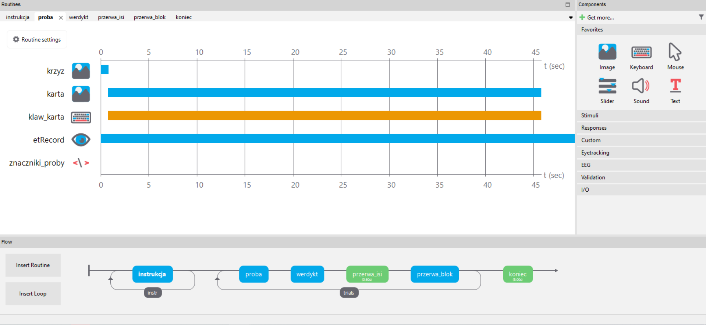
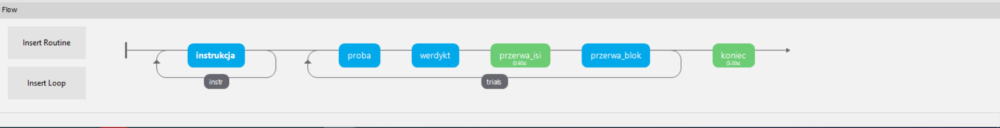

# BUILD BOOK – P1 „Czy to napisało AI?” (PsychoPy)
---

## 0. Metryczka

| Pole | Wartość |
|---|---|
| Przedmiot / karta | LBK · KL-A (rozdz. 0, 1, 14) · KL-B (rozdz. 3, 4, 6) |
| Zespół | Yevhen Rohozhynskyi (YR) · Vladyslav Uharov (VU) |
| Pakiet LBK | **P1** – Etykieta źródła AI a alokacja uwagi wzrokowej i ocena dowodów |
| Badanie w archiwum LBK | **Badanie 7 – „Czy jawna etykieta AI usypia naszą czujność”** (`Badania_2026-2027`); pliki identyczne z pakietem P1 (sumy MD5 zgodne) – protokół `A_PROTOKOL_BADAWCZY.md`, bodźce `LBK_2`, listy `LBK_3` |
| Zgłoszenie w forum „Pytania do projektu”| 09.11.2026 – YR |
| Materiały źródłowe | `A_PROTOKOL_BADAWCZY.md` (protokół, v1.0), `B_INSIGHTLAB_BUILD_PACKAGE.md`, `LBK_1_dokumenty_i_skrypty.zip`, `LBK_2_bodzce_plansze_i_ekrany.zip`, `LBK_3_listy_gotowe_do_podmiany.zip` |
| Narzędzie budowy | PsychoPy Standalone **2026.2.5** (Windows, x64) – ta sama u YR i VU |
| Aparatura docelowa (LBK) | EyeLogic Lite 120 Hz / LogicOne 250 Hz; monitor 24″ 1920 × 1080, dystans 60–65 cm (1° ≈ 41 px) |
| Układ | 2 × 2 × 2 wewnątrzosobowo, 24 triale + 6 treningowych, 16 list (8 × 2 kierunki) |
| Repozytorium | KL-A: https://github.com/s0nelywy111/repo_P1_KL-A_1 (tagi `KL-A`, `KL-A-poprawka`) · KL-B: https://github.com/s0nelywy111/repo_P1_KL-B (tag `KL-B`) |
| Wersja Build Booka | 0.2 (16.11.2026) |

### Struktura repozytorium

```
BUILD_BOOK.md
README.md
dane/nagranie.jsonl                      ← 60 s z symulatora (KL-A)
dane/xdf/sesja_KL-B.xdf (+ .png)         ← 2 min LabRecorder + wykres (KL-B)
eksperyment/P1_szkielet.psyexp           ← szkielet badania (KL-B)
eksperyment/warunki/                     ← warunki_L1.csv, instrukcje.csv
eksperyment/bodzce/                      ← L1/trial_01..24.png, sluzbowe/*.png (z pakietu P1)
eksperyment/kod_code_components/         ← kod wszystkich Code Components
narzedzia/                               ← symulator, klient, sim_to_lsl.py, linie_testowe.jsonl, zbuduj_psyexp.py
analiza/wykres_xdf.py                    ← wykres EDA + znaczniki z XDF
dokumentacja/                            ← schemat_petli.md, karta_zrodel.md, zrzuty/
```
---

## 1. Instalacja (dotychczasowe kroki)

| # | Krok | Polecenie / działanie | Oczekiwany wynik | Autor |
|---|---|---|---|---|
| 1.1 | Pobranie PsychoPy Standalone | psychopy.org → *Download* → Standalone dla Windows, plik `StandalonePsychoPy-2026.2.5-…-win64.exe`  | instalator na dysku | YR|
| 1.2 | Instalacja | uruchomić instalator; ścieżka instalacji `D:\Program\PsychoPy` | w menu Start: „PsychoPy-2026.2.5” | YR|
| 1.3 | Pierwsze uruchomienie | menu Start → PsychoPy-2026.2.5; zamknąć okna „Porada dnia” i „Changes in …” (OK). Otwiera się **Runner**; Builder: *Window → Show builder* | okno *PsychoPy Builder (v2026.2.5)* | YR |
| 1.4 | Odczyt wersji | pasek tytułu okna Builder/Runner (lub *Help → About*) | wersja: **2026.2.5** | YR |
| 1.5 | Demo | Builder: *Demos → Unpack Demos…* → wybrać folder *Dokumenty* (PsychoPy tworzy w nim `PsychoPy3 Demos`) → *Demos → Experiments → stroop* → zamknąć okno readme → przełącznik *Pilot/Run* na **Run** → zielony przycisk ▶ → w oknie dialogowym `participant` = `test`, OK → odpowiedzi strzałkami: ← czerwone, ↓ zielone, → niebieskie litery | wszystkie triale przechodzą; Runner, zakładka *Stdout*: `## Running: …\PsychoPy3 Demos\Experiments\stroop\stroop_lastrun.py ##` | YR |
| 1.6 | Ta sama wersja u drugiej osoby | powtórzyć 1.1–1.5 | wersja **identyczna** z 1.4: **2026.2.5** | VU|
| 1.7 | Python do skryptów pomocniczych | `python --version` (≥ 3.8) | **Python 3.13.5** | VU|
| 1.8 | Repozytorium | utworzyć prywatne repo **GitHub**, dodać prowadzącego (*Read*), `git clone https://github.com/s0nelywy111/repo_P1_KL-A_1.git` | lokalna kopia | VU |
| 1.9 | Symulator | pobrać z platformy AHE „Kod do laboratorium – symulator i klient startowy” (*Pobierz folder*) → rozpakować do `narzedzia/` → `python narzedzia/symulator_biosygnalow.py --mode file --duration 60 --out dane/nagranie.jsonl` (Python 3.8+, tylko biblioteka standardowa; bez `--seed` wartości różnią się przy każdym uruchomieniu – dla powtarzalności dodać np. `--seed 1`) | komunikat `Zapisano dane/nagranie.jsonl`; 241 linii JSON (t = 0…60 s, 4 Hz) | YR |
| 1.10 | Opis pól | `python narzedzia/opisz_nagranie.py dane/nagranie.jsonl` | 8 pól: `t, seq, hr, rr_ms, eda_us, focus, quality, scenario`; ≈ 4 rekordy/s; brak wzroku, źrenicy, oddechu | YR |
| 1.11 | Wersja i tag | `git add . && git commit -m "KL-A" && git tag KL-A && git push --tags` | tag `KL-A` widoczny w repo | VU |

**Problemy napotkane i rozwiązania**

| Problem | Rozwiązanie | Autor |
|---|---|---|
| Demo *stroop* (2026.2.5): po ostatnim trialu `IndexError: list index out of range` w `trials.saveAsExcel(...)` (`psychopy\data\trial.py`, l. 1496); „Experiment ended with exit code 1”. Wszystkie triale wyświetliły się i przyjmowały odpowiedzi – błąd dotyczy tylko eksportu .xlsx w demie. | Uznajemy demo za uruchomione: plik `PsychoPy3 Demos\Experiments\stroop\data\test_2026-11-09_21h37.35.386.csv` powstał mimo błędu – 30 triali (5 powtórzeń × 6 warunków), `psychopyVersion` = 2026.2.5, `frameRate` ≈ 165 Hz, wszystkie odpowiedzi poprawne. RT ≈ 2,7–3,4 s są sztucznie długie (odpowiedzi wprowadzane zdalnie, test techniczny, nie dane uczestnika). We własnym eksperymencie nie używamy `saveAsExcel` – zapis domyślny CSV. | YR |
| Ostrzeżenia `Parameters not known to this version of PsychoPy` (parametry eye-trackera: `elAddress`, `plPupil…`, `tbModel`…) przy generowaniu skryptu dema | nieszkodliwe – plik dema zawiera ustawienia z innej wersji; nie dotyczy działania | YR|

---

## 3. Budowa szkieletu eksperymentu krok po kroku (KL-B)

> Wynik: `eksperyment/P1_szkielet.psyexp`. Ten sam plik można wygenerować skryptem `python narzedzia/zbuduj_psyexp.py` (API PsychoPy 2026.2.5) – kroki niżej opisują budowę ręczną w Builderze i są źródłem prawdy.
> „zrzut:” = link do zrzutu ekranu w `dokumentacja/zrzuty/` (wszystkie zrzuty w 3.20). Zrzuty z PsychoPy 2026.2.5, 24.11.2026.

**Przebieg (Flow):** `[instr: instrukcja]` → `[trials: proba → werdykt → przerwa_isi → przerwa_blok]` → `koniec`

```
instr ┌ instrukcja ┐   trials ┌ proba → werdykt → przerwa_isi → przerwa_blok ┐   koniec
      └────────────┘          └───────────────────────────────────────────────┘
```

| # | Krok | Działanie w Builderze | Oczekiwany wynik | Autor |
|---|---|---|---|---|
| 3.1 | Folder eksperymentu | Skopiować `eksperyment/` z repo. Bodźce: `eksperyment/bodzce/L1/trial_01..24.png` (z `LBK_3_listy_gotowe_do_podmiany.zip → LISTA_L1`) i `eksperyment/bodzce/sluzbowe/` (`krzyz_fiksacyjny.png`, `E02–E04, E06–E08`, `Q1.png` z `LBK_2_bodzce_plansze_i_ekrany.zip`). Builder: *File → New*, *File → Save as* `eksperyment/P1_szkielet.psyexp` | plik .psyexp obok folderów `bodzce/`, `warunki/` | YR |
| 3.2 | Ustawienia – Basic | ⚙ *Experiment Settings → Basic*: Experiment name `P1_szkielet`; Experiment info: `participant`, `session` | [zrzut: 03_02_basic.png](dokumentacja/zrzuty/03_02_basic.png) | VU |
| 3.3 | Ustawienia – Screen | *Screen*: Window size `[1920, 1080]`, Full-screen ✔, Units **pix**, Color `[233, 236, 240]`, Color space **rgb255** (tło z protokołu), Show mouse ✘ | [zrzut: 03_03_screen.png](dokumentacja/zrzuty/03_03_screen.png) | YR |
| 3.4 | Ustawienia – Data | *Data*: Save csv ✔, Save excel ✘ (błąd `saveAsExcel` z KL-A), **Save hdf5 ✔** (dane MouseGaze) | [zrzut: 03_04_data.png](dokumentacja/zrzuty/03_04_data.png) | VU |
| 3.5 | Ustawienia – Input | *Input*: Keyboard Backend **ioHub** (alert 4550 dla eksperymentów z eye-trackerem) | brak alertu 4550 | YR |
| 3.6 | Ustawienia – Eyetracking | *Eyetracking*: Eyetracker Device **MouseGaze** wybrany z listy – muszą pojawić się pola *Move button* = CONTINUOUS, *Blink button* = MIDDLE_BUTTON, *Saccade threshold* = 0.5. W pliku .psyexp wartość to klucz `eyetracker.hw.mouse.EyeTracker`. Jeśli pola się nie pokazują, wartość jest nieważna i `etRecord.start()` kończy się błędem `'NoneType' object has no attribute 'isRecordingEnabled'` (sprawdzone 20.11) | [zrzut: 03_06_eyetracking.png](dokumentacja/zrzuty/03_06_eyetracking.png) | VU |
| 3.7 | Rutyna `instrukcja` | Nowa rutyna `instrukcja`. Image `instr_obraz`: Image `$ekran` (**set every repeat**), Size `[1920, 1080]`, Units pix, Start 0, Stop puste. Keyboard `instr_klaw`: keys `'space'`, Force end ✔, store last key | [zrzut: 03_07_instrukcja.png](dokumentacja/zrzuty/03_07_instrukcja.png) | YR |
| 3.8 | Kod `lsl_init` | Code Component `lsl_init` w `instrukcja`, Code Type **Py**: zakładki *Begin Experiment / Begin Routine / Each Frame / End Experiment* = pliki `eksperyment/kod_code_components/lsl_init__*.py` (wkleić zawartość). Szczegóły → rozdz. 6 | `03_08_lsl_init.png` | VU |
| 3.9 | Rutyna `proba` | Image `krzyz`: `bodzce/sluzbowe/krzyz_fiksacyjny.png`, start 0,0 s, duration **0,8 s**. Image `karta`: `$obraz`, set every repeat, start **0,8 s**, duration **45 s**, size `[1920, 1080]`. Keyboard `klaw_karta`: `'space'`, start 0,8, duration 45, Force end ✔ | karta 1:1 na pełnym ekranie; [zrzut: 03_09_proba.png](dokumentacja/zrzuty/03_09_proba.png) | YR |
| 3.10 | Eyetracker Record | W `proba`: *Eyetracking → Eyetracker Record* `etRecord`: Record actions **Start and Stop**, start 0, Stop with routine ✔ | [zrzut: 03_10_etRecord.png](dokumentacja/zrzuty/03_10_etRecord.png) | VU |
| 3.11 | Kod `znaczniki_proby` | Code Component **na samym dole** listy komponentów `proba` (musi być pod `karta` – inaczej `stim:onset` spóźni się o 1 klatkę). Zakładki z `znaczniki_proby__*.py` | [zrzut: 03_11_kolejnosc.png](dokumentacja/zrzuty/03_11_kolejnosc.png) (kolejność komponentów) | YR |
| 3.12 | Rutyna `werdykt` | Image `q1`: `bodzce/sluzbowe/Q1.png`, 1920×1080. Keyboard `werdykt_klaw`: keys `'f','j'`, Force end ✔, *Data*: Store correct ✔, Correct answer `$poprawny_klawisz`. Code `znacznik_resp` **pod** klawiaturą (`znacznik_resp__*.py`) | F = uzasadniony, J = nieuzasadniony (protokół 9.1) | VU |
| 3.13 | Rutyna `przerwa_isi` | Text `isi_pusty`: tekst pusty, start 0, duration **0,6 s** (bez komponentu z czasem trwania rutyna kończy się od razu – sprawdzone 20.11: `resp`→`trial:end` = 1 ms). Routine settings: *Stop* = duration 0,6 s. Code `lsl_klatka_isi`: Each Frame `lsl_klatka__each_frame.py`, End Routine `przerwa_isi__end_routine.py` | pusty ekran w kolorze tła 600 ms | YR |
| 3.14 | Rutyna `przerwa_blok` | Image `przerwa_obraz` (`E07_przerwa.png`) + Keyboard `przerwa_klaw` (`'space'`) + Code `lsl_klatka_blok` (Each Frame). Routine settings → *Skip if…*: `trial not in (8, 16)` | przerwa tylko po trialu 8 i 16 | VU |
| 3.15 | Rutyna `koniec` | Image `koniec_obraz` (`E08_koniec_czesci.png`) 5 s + Keyboard `'space'` 5 s + Code `lsl_klatka_koniec` (Each Frame) | | YR |
| 3.16 | Pętla `instr` | *Insert Loop* wokół `instrukcja`: name `instr`, loopType **sequential**, nReps 1, Conditions `warunki/instrukcje.csv` | Builder pokazuje „4 conditions, with 1 parameters [ekran]” | VU |
| 3.17 | Pętla `trials` | *Insert Loop* od `proba` do `przerwa_blok`: name `trials`, **sequential** (kolejność listy L1 jest już zrandomizowana z ograniczeniami w pakiecie), nReps 1, Conditions `warunki/warunki_L1.csv`. Tylko 1 blok (8 triali): *Selected rows* `0:8` | „24 conditions, with 14 parameters …”; [zrzut: 03_17_flow.png](dokumentacja/zrzuty/03_17_flow.png) | YR |
| 3.18 | Kompilacja | *Compile to script* (ikona Pythona) | plik `P1_szkielet.py`; alert **2115** („stimulus size exceeds X/Y dimension”) dla obrazów 1920×1080 jest fałszywy – test alertu podwaja rozmiar w pix (`convertToPix(...) * 2`), eksperyment działa poprawnie | VU |
| 3.19 | Uruchomienie testowe | Najpierw symulator i most (6.5), potem *Run*. Mysz = spojrzenie (MouseGaze). | dane w `eksperyment/data/`: `*.csv` (kolumny warunków + `werdykt_klaw.corr`, `lsl_hr_sr_5s`, …) i `*.hdf5` (MouseGaze) | YR |


### 3.20 Zrzuty ekranu

**03_02_basic** – Experiment Settings → Basic



**03_03_screen** – Experiment Settings → Screen (pełny ekran, pix, tło 233,236,240, rgb255)



**03_04_data** – Experiment Settings → Data (csv, hdf5, bez Excel)



**03_06_eyetracking** – Experiment Settings → Eyetracking (MouseGaze, CONTINUOUS, MIDDLE_BUTTON)



**03_07_instrukcja** – instr_obraz – $ekran, set every repeat



**03_08_lsl_init** – Code Component lsl_init – Begin Experiment



**03_09_proba** – rutyna proba – oś czasu (krzyz, karta, klaw_karta, etRecord, znaczniki_proby)



**03_10_etRecord** – etRecord – Start and Stop, Stop with Routine



**03_11_kolejnosc** – kolejność komponentów w proba – znaczniki_proby na dole



**03_17_flow** – Flow: [instr: instrukcja] → [trials: proba, werdykt, przerwa_isi, przerwa_blok] → koniec



**Dane wyjściowe (`eksperyment/data/<participant>_P1_szkielet_<data>.csv`; w repo przykładowy pełny przebieg `pilot_P1_szkielet_2026-11-24_15h25.27.225.csv` – ten sam, co nagranie XDF: 24 triale, 24/24 poprawnych)** – jeden wiersz na trial: wszystkie kolumny pliku warunków, `karta.started`, `klaw_karta.rt` (czas czytania), `werdykt_klaw.keys/.corr/.rt`, `lsl_hr_sr_5s`, `lsl_rmssd_5s`, `lsl_eda_med_5s`, `lsl_pominiete`. Spojrzenie MouseGaze → plik `.hdf5`.

---

## 4. Plik warunków

Autorzy rozdziału: YR (kolumny i zbalansowanie), VU (przykładowe wiersze, plik instrukcji).

`eksperyment/warunki/warunki_L1.csv` – 24 wiersze = lista **L1** z `tabela_triali.csv` pakietu P1 (kolejność zapieczona w pakiecie, ziarno 20260817). Zbalansowanie: każda z 8 kombinacji sprawca × weryfikacja × wersja występuje 3 razy (sprawdzone skryptem).

| Kolumna | Typ | Znaczenie | Gdzie użyta |
|---|---|---|---|
| `trial` | int 1–24 | numer triala na liście | znaczniki LSL, *Skip if* w `przerwa_blok` |
| `blok` | int 1–3 | blok po 8 triali | znaczniki, analiza |
| `obraz` | ścieżka | plik karty względem `.psyexp`, np. `bodzce/L1/trial_01.png` | Image `karta` (`$obraz`) |
| `temat` | T01–T24 | pozycja bodźcowa | znacznik `trial:start` |
| `domena` | tekst | dziedzina tematu (`A_sen`, `B_nauka`, …) | analiza |
| `zrodlo` | H0/H1/A0/A1 | kod etykiety: H = redaktor, A = system AI; 0/1 = weryfikacja | analiza |
| `sprawca` | H / A | czynnik SPRAWCA | znacznik, analiza |
| `weryfikacja` | 0 / 1 | czynnik WERYFIKACJA (1 = ekspert dziedziny) | znacznik, analiza |
| `wersja` | W / N | wniosek uzasadniony / nieuzasadniony | znacznik, analiza |
| `poprawna_odp` | TAK / NIE | poprawny werdykt | analiza |
| `poprawny_klawisz` | f / j | TAK → `f`, NIE → `j` | Keyboard `werdykt_klaw` (*Correct answer*) |
| `slot1_rola`, `slot2_rola` | WYNIK / KRYTYCZNY | rola bloków dowodowych (AOI `SLOT1`/`SLOT2`) – do CEAP | analiza AOI |
| `plik_zrodlowy` | nazwa | plansza źródłowa, np. `T04_N_H1.png` | kontrola zgodności |

Przykładowe wiersze:

```csv
trial,blok,obraz,temat,domena,zrodlo,sprawca,weryfikacja,wersja,poprawna_odp,poprawny_klawisz,slot1_rola,slot2_rola,plik_zrodlowy
1,1,bodzce/L1/trial_01.png,T04,A_sen,H1,H,1,N,NIE,j,KRYTYCZNY,WYNIK,T04_N_H1.png
2,1,bodzce/L1/trial_02.png,T05,B_nauka,A0,A,0,W,TAK,f,WYNIK,KRYTYCZNY,T05_W_A0.png
3,1,bodzce/L1/trial_03.png,T02,A_sen,H0,H,0,N,NIE,j,KRYTYCZNY,WYNIK,T02_N_H0.png
```

`eksperyment/warunki/instrukcje.csv` – 1 kolumna `ekran`, 4 wiersze: `E02_instrukcja1`, `E03_instrukcja2`, `E04_instrukcja3`, `E06_start_glowny` (ścieżki `bodzce/sluzbowe/…png`).

**Inna lista (L2…L8r):** podmienić PNG w `bodzce/L1/` na pliki z `LISTA_Lx` i wygenerować CSV z `tabela_triali.csv` filtrem `lista == Lx` (te same kolumny).

---

## 6. Strumienie LSL, znaczniki, most, LabRecorder

### 6.1 Instalacja

| # | Krok | Polecenie / działanie | Wynik | Autor |
|---|---|---|---|---|
| 6.1.1 | pylsl w PsychoPy | Builder: *Tools → Plugin/packages manager → Packages* → wyszukać `pylsl` → *Install* (alternatywnie *Open PIP terminal*: `pip install pylsl`). Restart PsychoPy | `import pylsl` działa w Code Component | VU |
| 6.1.2 | Python do mostu | most uruchamiamy Pythonem z PsychoPy (ma już pylsl): `D:\Program\PsychoPy\python.exe narzedzia\sim_to_lsl.py` | | YR |
| 6.1.3 | LabRecorder | github.com/labstreaminglayer/App-LabRecorder → *Releases* → archiwum Windows (`LabRecorder-…-Win_amd64.zip`), rozpakować do `D:\Program\LabRecorder\`, uruchomić `LabRecorder.exe`. Wersja: **[UZUPEŁNIĆ]**. Przy błędzie DLL: zainstalować Microsoft Visual C++ Redistributable | okno LabRecorder | VU |
| 6.1.4 | pyxdf do wykresu | `python -m pip install pyxdf matplotlib numpy` | | YR |

### 6.2 Strumienie

| Strumień | Typ | Kanały | Częstotliwość | Format | Kto nadaje |
|---|---|---|---|---|---|
| **LBK_Sim** | Physio | 11: `t_sim, seq, hr, rr_ms, eda_us, focus, quality, gaze_x, gaze_y, pupil_mm, resp` (jednostki w opisie strumienia `desc/channels`) | 4 Hz (nominalnie) | float32 | `narzedzia/sim_to_lsl.py` |
| **LBK_Markers** | Markers | 1 (tekst) | nieregularny (0) | string | Code Component `lsl_init` w PsychoPy |

`quality`: 0 = ok, 1 = noisy, 2 = lost (kody w `desc/quality_codes`). Pola, których symulator nie wysyła (`gaze_x`, `gaze_y`, `pupil_mm`, `resp`), i każde brakujące lub `null` pole → **NaN**.

### 6.3 Słownik znaczników

Format: `nazwa|klucz=wartość|…` (część przed pierwszym `|` = typ zdarzenia). **[SPRAWDZIĆ]** nazwy ze słownikiem na stronie „Badania LBK – pakiety, architektura, wspólny format” – w razie różnic zmienić tylko teksty w `kod_code_components/*.py`.

| Znacznik | Kiedy | Jak wysyłany | Przykład |
|---|---|---|---|
| `exp:start` | pierwsza klatka pierwszej próby (krzyż triala 1) – **nie** pierwszy ekran instrukcji: w trakcie instrukcji uruchamiamy LabRecorder, więc znacznik wysłany wcześniej nie trafiłby do XDF (sprawdzone 20.11: nagranie bez `exp:start`) | `win.callOnFlip` w Begin Routine `proba`, gdy `trials.thisN == 0` (przed `trial:start` tego samego flipu) | `exp:start\|uczestnik=123456\|lista=L1` |
| `trial:start` | pojawienie się krzyża fiksacyjnego | `win.callOnFlip` w Begin Routine `proba` | `trial:start\|trial=3\|blok=1\|temat=T02\|sprawca=H\|weryfikacja=0\|wersja=N` |
| `stim:onset` | pierwsza klatka karty | `win.callOnFlip` w klatce, w której `karta.status == STARTED` | `stim:onset\|trial=3\|obraz=bodzce/L1/trial_03.png` |
| `stim:offset` | koniec karty (SPACJA lub 45 s) | End Routine `proba` | `stim:offset\|trial=3\|czytanie_s=27.412` |
| `resp` | naciśnięcie F/J | Each Frame `werdykt` (≤ 1 klatka po naciśnięciu) | `resp\|trial=3\|klawisz=j\|poprawny=1` |
| `trial:end` | koniec przerwy 600 ms | End Routine `przerwa_isi` | `trial:end\|trial=3` |
| `exp:end` | koniec eksperymentu | End Experiment (+ 0,5 s na odbiór) | `exp:end\|odebrane=812\|pominiete=37` |

### 6.4 Most `sim_to_lsl.py` i linie testowe

- Łączy się z `127.0.0.1:5555`, czyta NDJSON, publikuje `LBK_Sim`. Brakujące pole / `null` / tekst zamiast liczby → NaN; zła linia JSON → pominięta i policzona; zerwane połączenie → ponowna próba co 2 s. Most się nie zatrzymuje.
- Test bez symulatora: `python narzedzia/sim_to_lsl.py --plik narzedzia/linie_testowe.jsonl --tylko-wypisz`
  Plik zawiera 4 linie: (1) **z polami wzroku i oddechu** (`gaze_x`, `gaze_y`, `pupil_mm`, `resp`), (2) **bez nich** i bez `rr_ms`/`focus`, (3) `quality: lost` z wartościami `null`, (4) tekst niebędący JSON.
  Oczekiwany wynik: 3 próbki; w 1. wszystkie kanały liczbowe, w 2. NaN w `rr_ms`, `focus`, `gaze_*`, `pupil_mm`, `resp`; w 3. NaN wszędzie poza `t_sim`, `seq`, `quality = 2`; komunikat `pominięto złych linii: 1`.

### 6.5 Odbiór w PsychoPy (okno 5 s)

`lsl_tick()` (Each Frame w każdej rutynie): `ContinuousResolver` szuka `LBK_Sim` w tle; po znalezieniu `pull_chunk(timeout=0.0)` w każdej klatce. Próbki z `quality ≠ 0` (także NaN) są pomijane i liczone. Okno kroczące 5 s wg znaczników czasu LSL. Co 1 s w konsoli eksperymentatora (Runner → *Stdout*, nie na ekranie uczestnika):

```
[LSL   377.4] okno 5 s: n=18 | HR_sr=67.5 bpm | RMSSD=48.6 ms | EDA_med=2.40 uS | pominiete (quality!=ok): 2 z 20
```

- **HR_sr** – średnia `hr` [bpm]; **RMSSD** = √(średnia z (RRᵢ₊₁ − RRᵢ)²) z kolejnych wartości `rr_ms` w oknie [ms]; **EDA_med** – mediana `eda_us` [µS].
- Uwaga: symulator podaje `rr_ms` co 250 ms, a nie raz na uderzenie serca, więc RMSSD z symulatora jest przybliżeniem; z EKG w LBK RR będzie na uderzenie.
- Wartości na koniec `werdykt` zapisywane do CSV: `lsl_hr_sr_5s`, `lsl_rmssd_5s`, `lsl_eda_med_5s`, `lsl_pominiete`.

### 6.6 Nagranie 2 min (LabRecorder → XDF) – kolejność ma znaczenie

| # | Krok | Polecenie / działanie | Wynik | Autor |
|---|---|---|---|---|
| 6.6.1 | Symulator | terminal 1: `python narzedzia/symulator_biosygnalow.py --mode tcp --scenario mix` | `Czekam na klienta na 127.0.0.1:5555` | VU |
| 6.6.2 | Most | terminal 2: `D:\Program\PsychoPy\python.exe narzedzia\sim_to_lsl.py` | `[most] połączono z symulatorem`, co 5 s licznik próbek | YR |
| 6.6.3 | PsychoPy | *Run* `P1_szkielet.psyexp`; zatrzymać się na **pierwszym ekranie instrukcji** (strumień `LBK_Markers` już istnieje) | w Stdout: `[LSL] połączono z LBK_Sim` i wydruk co 1 s | VU |
| 6.6.4 | LabRecorder | *Update* → zaznaczyć **LBK_Sim** i **LBK_Markers**; *Study root* `…\repo\dane\xdf`, File name `sesja_KL-B.xdf` → *Start* | licznik rośnie | YR |
| 6.6.5 | Przebieg | przejść instrukcje (`exp:start` wysyła się dopiero na pierwszej próbie, więc LabRecorder musi już nagrywać), wykonać ≥ 2 min triali (mysz = spojrzenie), dojść do ekranu końcowego (`exp:end`). Uruchamiać **jedną** kopię LabRecordera | | VU |
| 6.6.6 | Stop | po `exp:end` → LabRecorder *Stop* | `dane/xdf/sesja_KL-B.xdf` | YR |
| 6.6.7 | Wykres | `python analiza/wykres_xdf.py dane/xdf/sesja_KL-B.xdf` | `sesja_KL-B_eda_znaczniki.png` + podsumowanie (≥ 120 s, liczba znaczników każdego typu) | VU |

**Wynik (24.11.2026, PsychoPy 2026.2.5, LabRecorder 1.18.0, tryb Pilot):** `dane/xdf/sesja_KL-B.xdf` – LBK_Sim 1687 próbek, 421,5 s, 4,00 Hz, 50 próbek quality≠ok; LBK_Markers 122 znaczniki: `exp:start` 1, `trial:start` 24, `stim:onset` 24, `stim:offset` 24, `resp` 24 (24/24 poprawnych), `trial:end` 24, `exp:end` 1; `exp:start`→`exp:end` = 405,9 s; `trial:start`→`stim:onset` średnio 0,755 s (krzyż 0,8 s). Wykres: `dane/xdf/sesja_KL-B_eda_znaczniki.png`. LabRecorder zapisał plik pod nazwą domyślną BIDS (`sub-P001_ses-S001_task-Default_run-001_eeg.xdf`) – w repo przemianowany na `sesja_KL-B.xdf`.

Nagranie zawiera **wyłącznie** symulator i MouseGaze (wymóg karty). Zegary: pyxdf wyrównuje offsety zapisane przez LabRecorder, więc pionowe linie znaczników i EDA leżą na wspólnej osi czasu LSL.

Schemat pętli i opóźnienia: `dokumentacja/schemat_petli.md`. Źródła: `dokumentacja/karta_zrodel.md`.

---

## 14. Pierwsze pytania do LBK

| # | Pytanie | Dlaczego ważne dla P1 | Autor |
|---|---|---|---|
| 14.1 | Czy w LBK możemy sterować eksperymentem z PsychoPy (wtyczka EyeLogic do PsychoPy / ioHub), czy obowiązuje InsightLab? Którą wersję wtyczki i PsychoPy macie zainstalowaną? | od tego zależy, czy budujemy pętlę na `tabela_triali.csv`, czy liniowy łańcuch z pakietu B | YR |
| 14.2 | Który tracker będzie dostępny – Lite 120 Hz czy LogicOne 250 Hz? | 120 Hz wystarcza do dwell/fiksacji, nie do dynamiki sakkad | YR|
| 14.3 | Czy PsychoPy może wysyłać znaczniki zdarzeń (onset karty, SPACJA, odpowiedź) do zapisu okoruchowego i do EDA/EKG – wspólny zegar, LSL czy TTL? | bez synchronizacji nie policzymy CEAP dla karty ani okna SCR 1–5 s po karcie | VU |
| 14.4 | Czy eksport zawiera surowe próbki z flagą ważności i średnicą źrenicy, czy tylko gotowe fiksacje? Jaki algorytm i parametry detekcji fiksacji? | kryterium ≥ 70% ważnych próbek; protokół zakłada przeliczenie I2MC | VU |
| 14.5 | Ile punktów ma kalibracja, czy jest walidacja z błędem w stopniach i czy można rekalibrować w środku sesji (po trialu 8 i 16)? | kryterium < 1,0° i RMS < 0,5° | YR|
| 14.6 | Czy jest podpórka pod brodę i czy jasność monitora / oświetlenie są stałe i zmierzone? | dane źrenicy są interpretowalne tylko przy stałej luminancji | VU |
| 14.7 | Czy aparatura zapisuje obraz oka/twarzy domyślnie i czy da się to wyłączyć? | RODO – protokół zakłada brak wideo oka | YR |
| 14.8 | Czy można zablokować wszystkie klawisze poza F, J, 1–7, SPACJA? | odpowiedzi uczestnika w protokole | VU |
