# Schemat pętli biofeedbacku – P1 „Czy to napisało AI?” (KL-B)

Pętla: **bodziec → uczestnik → czujnik → LSL → PsychoPy → decyzja → zmiana → (następny bodziec)**.
„op. N” = miejsce opóźnienia; liczby to rzędy wielkości dla naszego stanowiska (symulator 4 Hz, monitor 60–165 Hz).

```mermaid
flowchart LR
    B["BODZIEC<br/>karta informacyjna P1<br/>(PNG 1920×1080)"]
    U["UCZESTNIK<br/>czytanie, ocena wiarygodności"]
    C["CZUJNIKI<br/>EDA/GSR, EKG (HR, RR)<br/>eye-tracker (MouseGaze / EyeLogic)"]
    M["MOST sim_to_lsl.py<br/>TCP → strumień LBK_Sim"]
    L["LSL<br/>LBK_Sim + LBK_Markers<br/>LabRecorder → XDF"]
    P["PsychoPy<br/>pull_chunk(0.0) co klatkę<br/>okno 5 s: HR, RMSSD, EDA"]
    D{"DECYZJA<br/>progi z histerezą<br/>(KL-C/D)"}
    Z["ZMIANA<br/>między próbami: przerwa,<br/>rekalibracja, flaga triala"]

    B -- "op. 1 flip + input lag monitora<br/>~7–17 ms + 10–30 ms" --> U
    U -- "op. 2 fizjologia: SCR 1–3 s,<br/>HR kilka uderzeń; sakkada ~200 ms" --> C
    C -- "op. 3 próbkowanie 4 Hz → do 250 ms<br/>+ bufor urządzenia" --> M
    M -- "op. 4 TCP + parsowanie ~1 ms;<br/>znacznik czasu = chwila odbioru" --> L
    L -- "op. 5 sieć lokalna <1 ms;<br/>zegary wyrównane offsetami LSL" --> P
    P -- "op. 6 czekanie na klatkę ≤1 klatka;<br/>okno 5 s = średnio ~2,5 s spóźnienia" --> D
    D -- "op. 7 wydruk/decyzja co 1 s" --> Z
    Z -- "op. 8 zastosowanie dopiero<br/>przed następnym trialem" --> B

    K["ZNACZNIKI LBK_Markers<br/>exp:start, trial:start,<br/>stim:onset (win.callOnFlip), resp, …"]
    P -. "push_sample na flip" .-> K
    K -.-> L
```

## Opóźnienia – zestawienie

| # | Odcinek | Skąd opóźnienie | Rząd wielkości | Czy kompensujemy? |
|---|---|---|---|---|
| 1 | PsychoPy → ekran | czekanie na odświeżenie + przetwarzanie obrazu w monitorze | 1 klatka (6–17 ms) + 10–30 ms | `stim:onset` wysyłany w `win.callOnFlip` → znacznik = chwila flipu; lag monitora pozostaje (pomiar fotodiodą w LBK) |
| 2 | Ekran → reakcja ciała | latencja fizjologiczna | EDA (SCR) 1–3 s; HR: kilka uderzeń; wzrok ~200 ms | nie da się – okno analizy SCR 1–5 s po `stim:onset` |
| 3 | Ciało → próbka | częstotliwość próbkowania i bufor czujnika | symulator 4 Hz → ≤ 250 ms | nie |
| 4 | Czujnik → LSL | TCP, parsowanie JSON; znacznik czasu nadawany przy odbiorze | ~1 ms (lokalnie), więcej przy `--latency-ms/--jitter-ms` | nie – w aparaturze LBK właściwy znacznik nadaje sterownik urządzenia |
| 5 | LSL → PsychoPy / LabRecorder | sieć; różne zegary komputerów | < 1 ms lokalnie | **tak** – LSL mierzy offsety zegarów, pyxdf wyrównuje je przy wczytaniu |
| 6 | Odbiór w PsychoPy | `pull_chunk(timeout=0.0)` raz na klatkę; okno kroczące 5 s | ≤ 1 klatka + średnio ~2,5 s (środek okna) | nie – świadomy kompromis stabilność ↔ szybkość |
| 7 | Decyzja | wydruk/aktualizacja co 1 s, progi z histerezą | ≤ 1 s | – |
| 8 | Zmiana | w P1 karta musi być identyczna dla wszystkich (kontrola bodźca) → zmiana tylko **między** trialami | do końca bieżącego triala (≤ 45 s + pytanie) | – |

**Wniosek dla P1:** pętla jest „wolna” (sekundy), bo dominują fizjologia (op. 2) i okno 5 s (op. 6). Dlatego adaptacja nie może zmieniać karty w trakcie czytania – to zmieniłoby bodziec i zniszczyło porównanie warunków. Sensowne zmiany: dodatkowa przerwa przy wysokim pobudzeniu, rekalibracja przy utracie śledzenia, oznaczenie triala jako podejrzanego w danych.
